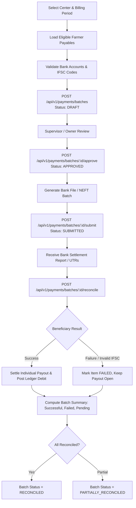

# Bulk Payment Batches Workflow

## 1. Overview & Purpose

Bulk Payment Batches automate the disbursement of milk settlement payments to hundreds of farmers at the conclusion of a billing period (e.g., 10-day, 15-day, or calendar month cycles).

The batch engine aggregates all eligible farmer payables, validates bank account and IFSC details, enforces Maker-Checker batch approvals, formats banking transaction files, and reconciles beneficiary settlement on an item-by-item basis.

---

## 2. Key Batch Engine Invariants

1. **Independent Beneficiary Idempotency:**
   Each beneficiary within a batch has an independent `customer_payouts` record and a `payment_batch_items` record. A failure on one beneficiary (e.g. inactive account, invalid IFSC) **does not abort or revert** valid settlements for other beneficiaries.

2. **No All-or-Nothing False Settlements:**
   A batch is never marked `SETTLED` as a monolith. If 98 transfers succeed and 2 fail:
   - 98 payouts are marked `SETTLED` and posted to the ledger.
   - 2 payouts are marked `FAILED` with failure reasons preserved.
   - The batch is marked `PARTIALLY_RECONCILED`.

3. **Masked Bank Account Numbers:**
   In compliance with security standards, all batch queries and item views mask bank account numbers as `XXXX-XXXX-1234` while preserving complete IFSC codes for routing.

4. **Billing Period Linkage:**
   Every batch retains immutable links to its origin `billing_period_start`, `billing_period_end`, and optional `billing_cycle_id`. Finalized collections and historical bills remain completely unmodified.
