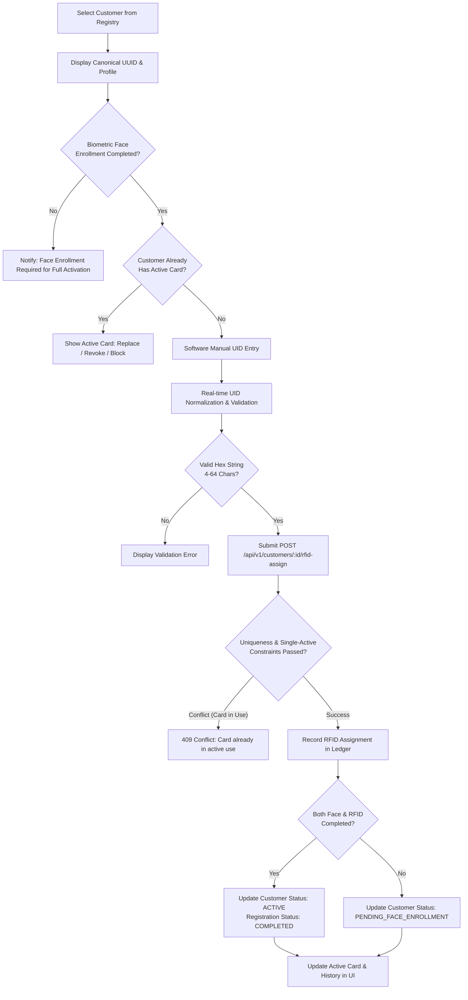

# DFarm: Customer RFID Card Assignment & Lifecycle Management

This document defines the end-to-end operational and technical workflow for assigning, replacing, revoking, and managing RFID cards within the DFarm Customer Registration Android Application (`apps/registration-android`) and Backend API services.

---

## 1. Architectural Boundary & Hardware Notice

> [!IMPORTANT]
> **Physical Hardware Reader Integration Deferred**:
> In accordance with Phase 08 project boundaries, direct integration with physical USB/UART/Wiegand RFID hardware readers is strictly deferred. 
> All card UID entries are accepted through the **Software Manual / Test UID Entry** interface backed by `SoftwareManualEntryRfidAdapter`. No low-level hardware communication is simulated or claimed.

---

## 2. Registration App Operational Workflow

---

## 3. Key Invariants & Business Rules

1. **Uniqueness Invariant**: An RFID card UID can be actively assigned to at most **one** customer across an entire organization at any given moment (`uq_active_card_assignment`).
2. **Single Active Card per Customer**: Under the approved system policy, a customer must not possess multiple concurrently active RFID card assignments (`uq_active_customer_card`).
3. **Card Reissuance via Replacement**: If a customer loses or damages their card, the officer must execute the **Card Replacement** workflow. Reissuing a card atomically revokes the previous assignment with an audit reason and issues the new card.
4. **RBAC Authorization**: Only authorized staff holding roles `REGISTRATION_OFFICER`, `CENTER_MANAGER`, `DAIRY_OWNER`, or `SUPER_ADMIN` may assign or replace cards.
5. **Software UID Normalization**:
   - Strips separators (colons `:`, hyphens `-`, spaces ` `).
   - Converts to uppercase hexadecimal representation:
     $$\text{"04:a1:b2:c3:d4"} \longrightarrow \text{"04A1B2C3D4"}$$

---

## 4. Replacement & Revocation Lifecycle

### 4.1 Replacement Workflow
- Triggered when an active card is compromised, lost, or physically damaged.
- Supported replacement reasons:
  - `DAMAGED`
  - `LOST`
  - `STOLEN`
  - `DEFECTIVE`
- **Atomic Execution**: Backend transaction sets previous assignment `is_active = FALSE`, updates previous card status to `REVOKED`, and assigns the target card UID as `ACTIVE`.

### 4.2 Card Blocking & Revocation
- **Card Revocation**: Deactivates the assignment and marks the card permanently unassigned or retired.
- **Card Blocking**: Places the card into `BLOCKED` status to prevent fraudulent intake taps at collection centers.

---

## 5. Customer Registration Activation Gate

A customer profile progresses through lifecycle states:
$$\text{DRAFT} \longrightarrow \text{PENDING\_FACE\_ENROLLMENT} \longrightarrow \text{PENDING\_RFID\_ASSIGNMENT} \longrightarrow \text{ACTIVE}$$

Only when **both** biometric face enrollment and unique RFID card assignment are verified does the customer transition to:
- `status = 'ACTIVE'`
- `registration_status = 'COMPLETED'`

Eligible active customers can then be reliably identified at collection counters across all three approved identification pathways.
