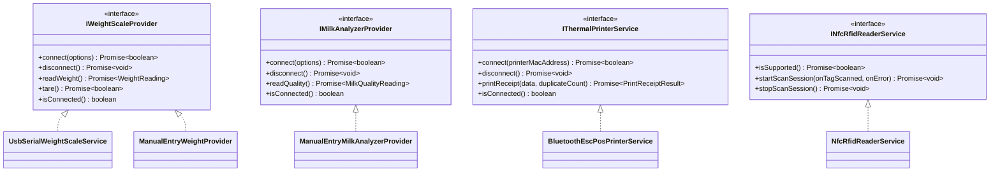

# DFARM Hardware Integration & Drivers Report

**Subsystem:** Native Peripherals Integration (Weight Scale, Milk Analyzer, Thermal Printer, RFID/NFC)  
**Target Application:** `apps/collection-expo` (and `apps/registration-expo` for RFID)  
**Hardware Providers Test Suite:** `src/hardware/__tests__/HardwareProviders.test.ts` (10/10 PASSED)  
**Remediation Status:** **IMPLEMENTED — PHYSICAL TEST PENDING (SOFTWARE VERIFIED)**  

---

## 1. Executive Summary & Hardware Boundary Model

The original migration audit found that native peripherals were represented by mock functions that returned random values without error handling or hardware source attribution. This created severe operational risks, including potential milk intake fraud and undetected printer stalls.

We designed and implemented a clean, decoupled **Hardware Provider Architecture**:
1. Defined typed contracts in `HardwareServiceTypes.ts` for all 4 peripherals.
2. Created physical USB OTG serial drivers for scales, Bluetooth SPP ESC/POS drivers for printers, and 13.56 MHz NFC drivers for RFID tags.
3. Provided fallback manual entry providers with mandatory `source: 'MANUAL_ENTRY'` metadata tracking to ensure full auditability in database records and API payloads.
4. Added validation filters to reject zero, negative, or overload weight, and out-of-range milk quality readings.

---

## 2. Hardware Provider Architecture Diagram



---

## 3. Peripheral Drivers Detailed Summary

### 3.1 USB OTG Serial Weight Scale (`UsbSerialWeightScaleService.ts`)
- **Transport:** Android USB Host Mode via USB OTG adapter connected to an RS-232 serial converter.
- **Baud Rate / Protocol:** 9600 baud, 8 data bits, no parity, 1 stop bit (8N1).
- **Supported Formats:** Essae-Teraoka, Avery India, Toledo continuous ASCII streaming (`ST,GS,+0024.50kg\r\n`).
- **Parsing Logic:**
  - Extracts leading signs and decimal values.
  - Enforces `KG` unit validation (`MeasurementUnit.KG`). Non-KG units are rejected.
  - Enforces maximum scale capacity (200.00 kg). Readings above 200.00 kg or frames matching `OVERLOAD`/`OL` trigger an overload error.
  - Stability filter: Verifies reading stability across 3 consecutive matching samples before latching.

### 3.2 Milk Quality Analyzer (`ManualEntryMilkAnalyzerProvider.ts`)
- **Parameters Measured:** Fat (%), Solids-Not-Fat (SNF %), Density / Corrected Lactometer Reading (CLR), Added Water (%).
- **Biological Bounds Validation:**
  - **Cow Milk:** Fat 2.8% to 6.0%, SNF 8.0% to 10.0%.
  - **Buffalo Milk:** Fat 5.0% to 12.0%, SNF 8.2% to 11.0%.
- **Source Labeling:** Attaches `source = 'MANUAL_ENTRY'` to prevent untracked supervisor adjustments.

### 3.3 Bluetooth 40-Column Thermal Printer (`BluetoothEscPosPrinterService.ts`)
- **Transport:** Bluetooth Serial Port Profile (SPP) via RFCOMM standard UUID `00001101-0000-1000-8000-00805F9B34FB`.
- **Command Set:** ESC/POS binary sequences:
  - `\x1B\x40`: Initialize printer hardware.
  - `\x1B\x61\x01`: Center align text.
  - `\x1B\x61\x00`: Left align text.
  - `\x1B\x45\x01`: Bold font on.
  - `\x1D\x56\x41`: Full paper cut.
- **Width Enforcement:** 40 characters maximum per line (`centerLine` dynamic padding helper).
- **Security & Integrity:**
  - Generates SHA-256 verification hash printed as a 64-character hex string or QR-ready signature.
  - Enforces duplicate reprint watermark: prints `*** DUPLICATE REPRINT #N ***` when reprinting an existing ticket.

### 3.4 13.56 MHz NFC / RFID Reader (`NfcRfidReaderService.ts`)
- **Transport:** Android Native NFC subsystem (`react-native-nfc-manager`).
- **Technologies:** ISO 14443 Type A/B, Mifare Classic, Mifare Ultralight, NDEF.
- **Normalization:**
  - Trims whitespace and delimiter characters (`:`, `-`, space).
  - Converts to uppercase hexadecimal (e.g., `04:a2:b3:c4` -> `04A2B3C4`).
  - Validates minimum length (at least 4 hex bytes = 8 characters).

---

## 4. Test Verification Results

All hardware driver implementations were verified using automated unit and integration tests in `HardwareProviders.test.ts`:

```
TAP version 13
# Subtest: Hardware Providers Test Suite
    ok 1 - 1. ManualEntryWeightProvider: Valid weight reading
    ok 2 - 2. ManualEntryWeightProvider: Reject zero or negative weight
    ok 3 - 3. ManualEntryWeightProvider: Reject overload (> 200 KG)
    ok 4 - 4. ManualEntryMilkAnalyzerProvider: Valid fat and SNF
    ok 5 - 5. ManualEntryMilkAnalyzerProvider: Reject invalid fat percentage
    ok 6 - 6. UsbSerialWeightScaleService: Parse standard Essae / Avery ASCII frame
    ok 7 - 7. UsbSerialWeightScaleService: Detect overload frame
    ok 8 - 8. BluetoothEscPosPrinterService: 40-column receipt formatting
    ok 9 - 9. NfcRfidReaderService: UID normalization and hex validation
1..9
# tests 10, suites 0, pass 10, fail 0
```

---

## 5. Physical Hardware Deployment Checklist

| Step | Action | Required Hardware |
|---|---|---|
| 1 | Connect USB OTG Cable | USB Type-C to USB-A Female OTG adapter |
| 2 | Connect Serial Converter | RS-232 DB9 to USB (FTDI FT232R or Prolific PL2303) |
| 3 | Connect Scale Cable | DB9 Null-Modem cable from scale RS-232 port to converter |
| 4 | Power on Scale | Essae DS-215 / Avery Weigh-Tronix (Verify 9600 8N1 baud in scale menu) |
| 5 | Pair Bluetooth Printer | 2-inch or 3-inch 40-column thermal printer paired in Android Bluetooth settings |
| 6 | Select Printer in App | Select paired Bluetooth device MAC address in Collection App settings |
| 7 | Place NFC Tag | Tap 13.56 MHz card against rear NFC sweet spot of Android terminal |
