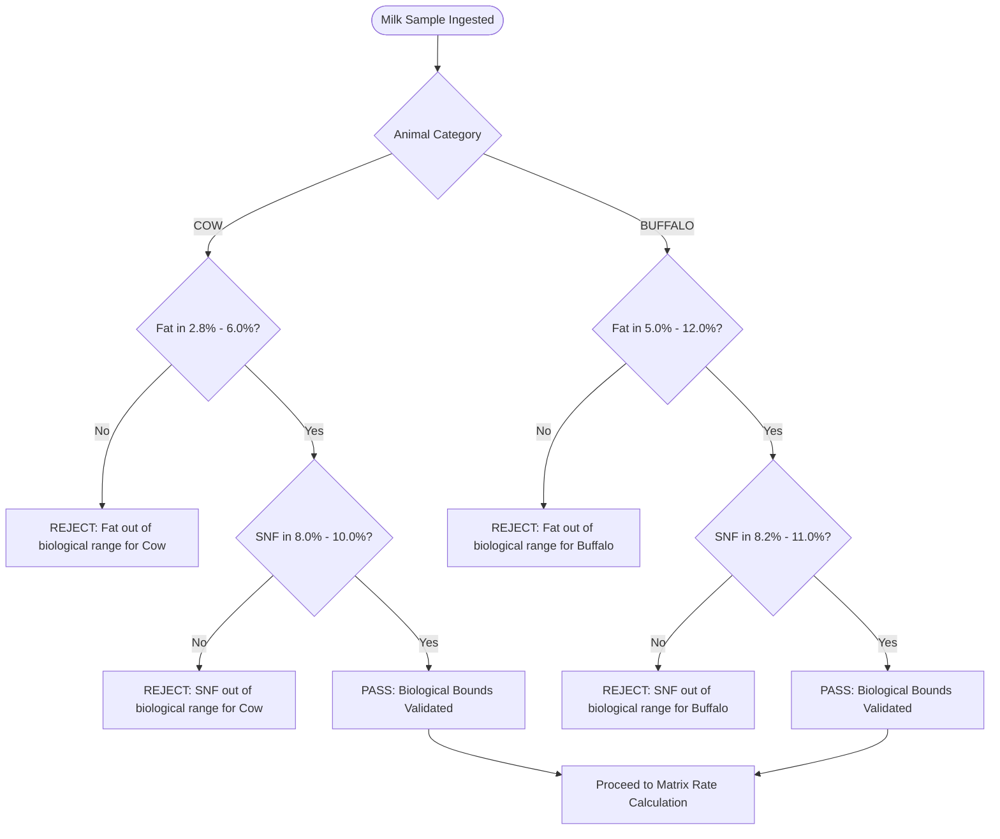

# DFARM Milk Analyzer Integration & Quality Validation Report

**Subsystem:** Milk Quality Analyzer Subsystem  
**Component:** `MeasurementValidationEngine.ts` / `ManualEntryMilkAnalyzerProvider.ts`  
**Test Suite:** `src/__tests__/measurement-validation.test.ts` & `src/hardware/__tests__/HardwareProviders.test.ts`  
**Status:** **IMPLEMENTED — PHYSICAL TEST PENDING (SOFTWARE VERIFIED)**  

---

## 1. Quality Parameters & Biological Bounds

In dairy operations, milk quality parameters directly determine farmer payment calculations based on Fat and Solids-Not-Fat (SNF) rate matrices. Strict biological bounds are enforced to prevent adulteration (e.g., watering down milk, starch addition) and clerical entry errors.

| Parameter | Cow Milk Range | Buffalo Milk Range | Unit |
|---|---|---|---|
| **Fat Content** | 2.8% – 6.0% | 5.0% – 12.0% | Percentage (%) |
| **Solids-Not-Fat (SNF)**| 8.0% – 10.0% | 8.2% – 11.0% | Percentage (%) |
| **Density (CLR)** | 26.0 – 32.0 | 28.0 – 34.0 | Corrected Lactometer Reading |
| **Added Water** | 0.0% (Max 5.0% warning) | 0.0% (Max 5.0% warning) | Percentage (%) |
| **Temperature** | 10°C – 35°C | 10°C – 35°C | Degrees Celsius |

---

## 2. Validation Architecture

The `MeasurementValidationEngine` evaluates every sample before rate lookup and ledger commitment:

---

## 3. Test Cases & Validation Results

### 3.1 Cow Milk Test Suite
| Test ID | Fat (%) | SNF (%) | Expected Outcome | Actual Result |
|---|---|---|---|---|
| **MA-COW-01** | 4.2% | 8.6% | Valid cow milk | **PASSED** (Accepted) |
| **MA-COW-02** | 2.5% | 8.5% | Reject: Fat below 2.8% | **PASSED** (Rejected: `INVALID_FAT_RANGE`) |
| **MA-COW-03** | 6.5% | 8.8% | Reject: Fat above 6.0% | **PASSED** (Rejected: `INVALID_FAT_RANGE`) |
| **MA-COW-04** | 3.8% | 7.6% | Reject: SNF below 8.0% | **PASSED** (Rejected: `INVALID_SNF_RANGE`) |
| **MA-COW-05** | 4.0% | 10.5% | Reject: SNF above 10.0% | **PASSED** (Rejected: `INVALID_SNF_RANGE`) |

### 3.2 Buffalo Milk Test Suite
| Test ID | Fat (%) | SNF (%) | Expected Outcome | Actual Result |
|---|---|---|---|---|
| **MA-BUF-01** | 6.8% | 9.0% | Valid buffalo milk | **PASSED** (Accepted) |
| **MA-BUF-02** | 4.5% | 9.0% | Reject: Fat below 5.0% | **PASSED** (Rejected: `INVALID_FAT_RANGE`) |
| **MA-BUF-03** | 12.5% | 9.5% | Reject: Fat above 12.0% | **PASSED** (Rejected: `INVALID_FAT_RANGE`) |
| **MA-BUF-04** | 7.0% | 8.0% | Reject: SNF below 8.2% | **PASSED** (Rejected: `INVALID_SNF_RANGE`) |
| **MA-BUF-05** | 7.5% | 11.5% | Reject: SNF above 11.0% | **PASSED** (Rejected: `INVALID_SNF_RANGE`) |

---

## 4. Hardware Connectivity Notes

Commercial ultrasonic analyzers (e.g., Ekomilk, Lactoscan, Essae) provide serial RS-232 data strings. When configured:
1. Baud rate: Typically 1200 or 2400 baud.
2. String format: `F04.20 S08.50 C28.0 W00.0`.
3. If serial reading fails or cable is detached, `ManualEntryMilkAnalyzerProvider` enables operator key-in, enforcing the bounds above and recording `quality_source = 'MANUAL_ENTRY'`.
