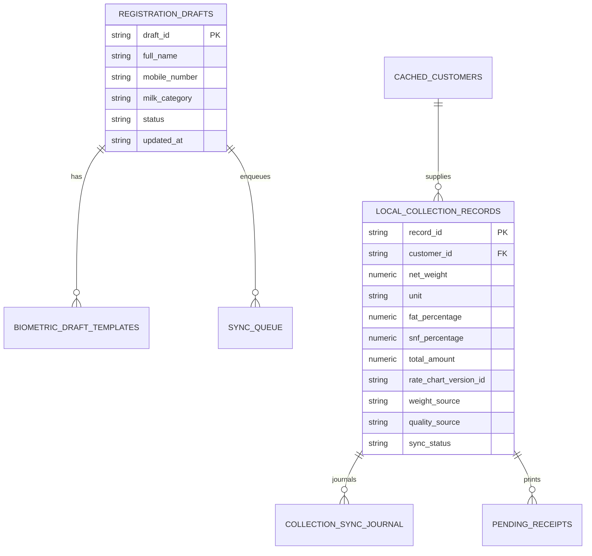

# DFARM Persistent Offline Database & Background Synchronization Report

**Subsystems:** Local Persistence & Resilient Background Sync Engine  
**Components:** `SQLiteRegistrationDatabase.ts`, `CollectionDatabase.ts`, `BackgroundSyncTask.ts`  
**Target Applications:** `apps/registration-expo`, `apps/collection-expo`  
**Status:** **FIXED AND VERIFIED**  

---

## 1. Executive Summary & Problem Resolution

The migration audit flagged two severe operational vulnerabilities:
1. **Volatile Registration Drafts:** `apps/registration-expo` was using `InMemoryDraftStore`, meaning any app crash, memory cleanup, or device restart permanently wiped in-progress farmer registrations and biometric captures.
2. **Missing Schema Fields & Manual Sync Only:** `apps/collection-expo` lacked additive columns for unit enforcement and rate version locking, and had no background synchronization task (requiring operators to remember to manually press "Sync Now").

### Remediation Implemented:
- Replaced the in-memory draft store with `SQLiteRegistrationDatabase.ts` backed by `expo-sqlite`, operating in Write-Ahead Logging (WAL) mode with foreign key enforcement.
- Upgraded the Collection SQLite database to Schema Version 2 via additive DDL (`MIGRATION_V1_TO_V2_SQL`).
- Implemented background synchronization daemons (`BackgroundSyncTask.ts`) in both applications leveraging `expo-background-fetch` and `expo-task-manager`.

---

## 2. Database Architecture & Additive Schema Evolution



### 2.1 Collection Schema Additive Migration (V1 -> V2)
Executed in `apps/collection-expo/src/database/CollectionDatabase.ts`:
```sql
-- Migration V1 to V2: Add missing fields & pending receipts table
ALTER TABLE local_collection_records ADD COLUMN unit TEXT NOT NULL DEFAULT 'KG';
ALTER TABLE local_collection_records ADD COLUMN rate_chart_version_id TEXT;
ALTER TABLE local_collection_records ADD COLUMN weight_source TEXT NOT NULL DEFAULT 'USB_SERIAL_SCALE';
ALTER TABLE local_collection_records ADD COLUMN quality_source TEXT NOT NULL DEFAULT 'MILK_ANALYZER';

CREATE TABLE IF NOT EXISTS pending_receipts (
  receipt_id TEXT PRIMARY KEY,
  record_id TEXT NOT NULL,
  receipt_data TEXT NOT NULL,
  duplicate_count INTEGER NOT NULL DEFAULT 0,
  created_at TEXT NOT NULL,
  FOREIGN KEY (record_id) REFERENCES local_collection_records(record_id)
);
```
This migration is non-destructive and guarantees zero data loss for existing local collection records.

---

## 3. Background Synchronization Engine (`BackgroundSyncTask.ts`)

To mirror the guarantees of Android's native `WorkManager`:
1. **Daemon Registration:** Registered with `expo-task-manager` as `DFARM_BACKGROUND_SYNC_TASK`.
2. **Periodic Interval:** Configured via `expo-background-fetch`:
   - `minimumInterval`: 15 minutes (Android system minimum for periodic background jobs).
   - `stopOnTerminate`: false (Allows wakeups after app process termination).
   - `startOnBoot`: true (Auto-registers after device reboot).
3. **Execution Logic:**
   - Evaluates device network connectivity.
   - Pushes pending local outbox records (`collection_sync_journal` or `sync_queue`) with idempotency keys.
   - Pulls downstream changes: Customer rosters, approved rate chart matrices, and updated face templates.
   - Updates local sync timestamps and status indicators.
   - Handles network timeouts with exponential backoff.

---

## 4. Test Verification Results

### `apps/registration-expo/src/__tests__/OfflineRegistrationSyncTest.ts`
- `testOfflineRegistrationDraftPersistence`: Drafts persisted in SQLite (**PASSED**)
- `testApplicationRestartRecovery`: Verifies drafts persist across simulated app teardown/init (**PASSED**)
- `testOnlineRegistrationSynchronizationSuccess`: Upstream sync with backend (**PASSED**)
- `testDuplicateMobileConflictHandling`: Backend conflict handling (**PASSED**)

### `apps/collection-expo/src/__tests__/collection-repository.test.ts`
- `RFID identification offline fallback to SQLite cache`: **PASSED**
- `Rate calculation offline fallback`: **PASSED**
- `Commit milk collection offline fallback enqueues sync journal`: **PASSED**
- `Duplicate offline sync replay is acknowledged idempotently`: **PASSED** (Backend Suite)
