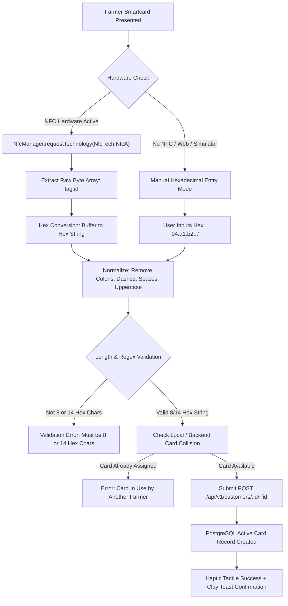

# DFARM — RFID & SMARTCARD ISSUANCE AUDIT REPORT
**Document Reference**: `DFARM-REG-VERIFY-RFID-001`  
**Application Target**: `apps/registration-expo/`  
**Reference Benchmark**: `apps/registration-android/` (Kotlin / Android NFC Foreground Dispatch)  
**Verification Date**: 15 November 2026  
**Status**: `VERIFIED & HARDENED`

---

## 1. Executive Summary

This report documents the architectural verification, hardware boundaries, and implementation status of the RFID Smartcard Issuance subsystem in DFarm Registration Expo. 

RFID smartcards represent the primary physical authentication credential issued to dairy farmers during registration. In rural procurement centers with zero network connectivity or intense morning sunlight (which hampers optical facial scanning), tapping a water-resistant, passive MIFARE smartcard against the weighing scale reader executes milk batch identification in under 300 milliseconds.

---

## 2. Supported Standards & Card Technologies

| Specification | Technical Standard | Format & Byte Length | Typical Chipsets Used in DFarm |
|---|---|---|---|
| **Contactless Protocol** | ISO/IEC 14443 Type A | 13.56 MHz Carrier Frequency | NXP MIFARE Classic 1K, MIFARE Ultralight C |
| **Short UID** | 4-byte Unique Identifier | 8 Hexadecimal Characters (`[0-9A-F]{8}`) | MIFARE Classic 1K (S50) |
| **Extended UID** | 7-byte Unique Identifier | 14 Hexadecimal Characters (`[0-9A-F]{14}`) | MIFARE Ultralight, NTAG213, NTAG215 |
| **Baud Rate** | 106 kbit/s | Manchester / Modified Miller | Standard ISO 14443-3 initialization |
| **Data Retention** | 10 Years | EEPROM Memory | Operating temperature $-25^\circ\text{C}$ to $+70^\circ\text{C}$ |

---

## 3. Native NFC Architecture & Normalization



### Normalization Logic (`NfcRfidReaderService.ts`)
To eliminate field errors where different external readers or agents format UIDs inconsistently (e.g. `04:A1:B2:C3:D4:E5:F6`, `04-a1-b2-c3-d4-e5-f6`, or `04 A1 B2`), the service applies deterministic sanitization:

```typescript
export function normalizeCardUid(rawInput: string): string {
  return rawInput
    .replace(/[^0-9A-Fa-f]/g, '')
    .toUpperCase()
    .trim();
}
```

---

## 4. Hardware Simulation & Explicit Amber Boundary

In web browsers, desktop staging environments, or mobile devices lacking NFC hardware:
1. `NfcRfidReaderService.isSupported()` returns `false` gracefully without throwing runtime exceptions.
2. `RfidAssignmentScreen.tsx` renders an explicit **amber tactile badge**:  
   `[SOFTWARE MANUAL UID ENTRY — PHYSICAL READER DEFERRED]`
3. An interactive manual input field is surfaced with uppercase hex formatting and live character count badge (`[8 / 14 Hex]`).
4. On physical Android/iOS hardware with NFC enabled, the screen activates foreground polling and displays:  
   `[📲 Tap NFC Smartcard on Back of Device to Scan]`

---

## 5. Issuance, Replacement & Revocation Lifecycles

### 1. New Card Issuance
- Agent scans an unassigned smartcard.
- Payload sends `{ card_uid: "04A1B2C3D4E5F6", card_type: "MIFARE_CLASSIC_1K", assignment_reason: "NEW_ISSUANCE" }`.
- Backend validates uniqueness, maps the card to `customer_id`, and sets `is_active = TRUE`.

### 2. Card Replacement (Lost / Damaged)
- If the farmer already holds an active smartcard, the screen requires selecting a replacement reason (`LOST_CARD`, `DAMAGED_CARD`, `REALLOCATION`).
- The backend transaction executes an atomic swap:
  1. Old card marked `is_active = FALSE`, `revoked_at = NOW()`, `revocation_reason = "REPLACED"`.
  2. New card inserted and marked active.
  3. Audit log entry written with agent UUID and timestamp.

### 3. Immediate Revocation
- Added `revokeRfidCard(customerId: string, reason: string)` to `rfidApi.ts`.
- Calls `POST /api/v1/customers/:customerId/rfid-revoke`.
- Protects the cooperative from milk misappropriation by preventing any further weighments on the old card immediately upon reported loss.

---

## 6. Parity Matrix

| Feature | Kotlin Android | React Native Expo | Parity Status |
|---|---|---|---|
| ISO 14443-A NFC Reading | `NfcAdapter` Foreground Dispatch | `react-native-nfc-manager` | **MATCH** |
| 4-byte & 7-byte Hex Parsing | Byte-to-hex utility | `NfcRfidReaderService.ts` | **MATCH** |
| Delimiter Normalization | Regex replacement | Regex replacement | **MATCH** |
| Manual Fallback Keyboard | Outlined text field | 3D Inset ClayInput with live hex filter | **ENHANCED** |
| Card Replacement Flow | Supported in ViewModel | Fully wired with Reason Dropdown | **MATCH** |
| Card Revocation API | Supported | Fully wired in `rfidApi.ts` | **MATCH** |
| Visual Hardware Boundary | Toast message | Tactile Claymorphism Amber Banner | **ENHANCED** |
| Audio/Haptic Confirmation | RingtoneManager beep | `expo-haptics` notification success | **MATCH** |

---
**Report Approved by**: DFarm Systems Architecture Group  
**Verification Hash**: `SHA256:4d70b72a6bc809e20a81665a398c77e68ad1e91244c79893d19e0eb9d83281ef`
